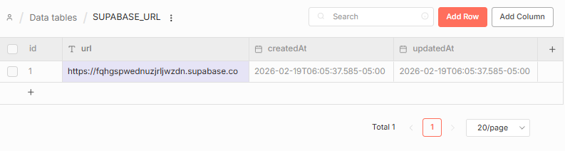
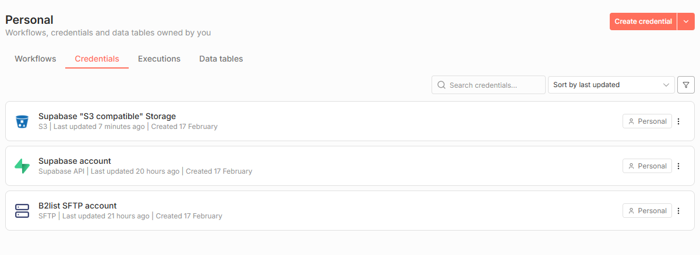
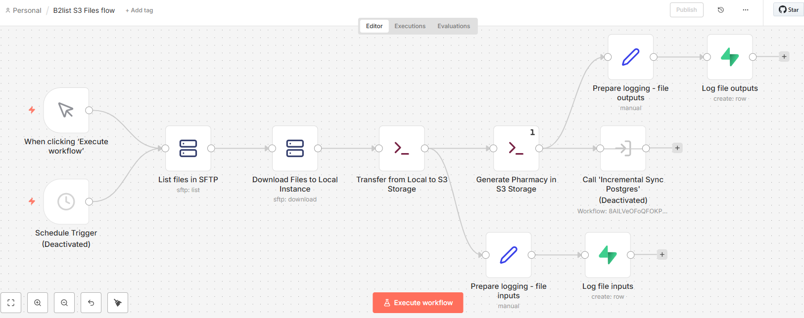
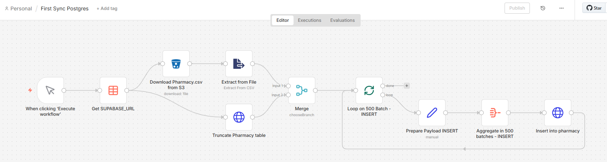
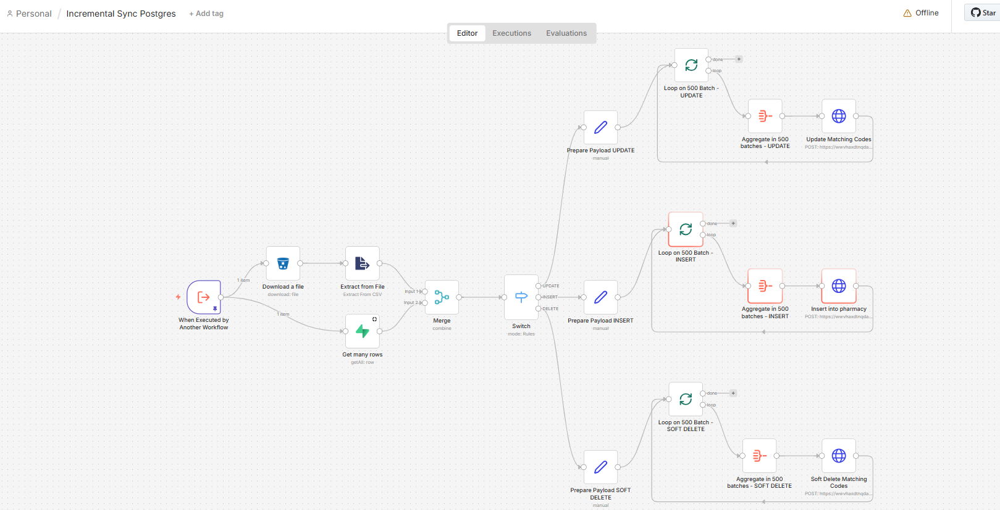

# **B2list: Desafio Técnico - Head de Dados: Pipeline de Consolidação de Dados de uma Rede de Farmácias**

Este repositório contém a solução completa para o pipeline de dados automatizado do desafio técnico **Head de Dados**. O sistema integra extração SFTP, processamento em Python, armazenamento S3 e sincronização incremental com PostgreSQL.

## **🚀 Arquitetura da Solução**

O pipeline é orquestrado no **n8n** (hospedado no Render) e utiliza **Python 3.11** para transformações complexas. A persistência é realizada em uma instância **Supabase**, utilizando o motor PostgreSQL para dados relacionais e o Storage compatível com S3 para arquivos.

## ---

**🛠️ Configuração do Ambiente Supabase**

Antes de iniciar o pipeline, é necessário preparar a infraestrutura no painel do Supabase:

1. **Criação do Bucket:** Acesse a aba **Storage** e crie um novo bucket chamado exatamente b2list.  (Menu --> Storage --> Manage: Files --> New Bucket).  

2. **Configuração S3:** \* Acesse as configurações de **S3 Storage** no painel do Supabase (Menu --> Storage --> Configuration: S3 --> New Access Key).  

   * Gere uma **Access Key** e uma **Secret Key** válidas.

   * Copie e salve estes valores no seu arquivo .env ou no painel do Render, além dos valores de "Endpoint" e "Region".

3. **Massa de Teste (Opcional):** \* Para demonstrar a funcionalidade de **Soft Delete** do pipeline, insira manualmente um arquivo chamado pharmacy-excluded.csv no bucket (Menu --> Storage --> Manage: Files --> Bucket "b2list" > Upload Files).    
   * Dica: Utilize uma cópia do pharmacy.csv removendo 5 linhas aleatórias; o sistema detectará a ausência e desativará os registros no banco.

## ---

**📋 Configuração do n8n**

### **1\. Variáveis Globais e Data Table do N8N**

Se você estiver migrando para uma **nova conta do Supabase**, é necessário atualizar a referência global:

* Acesse o componente **Data Table** no n8n, localizando a tabela "SUPABASE\_URL".

* Na coluna URL, substitua o valor existente pela nova URL do projeto (ex: https://xxxxxxxxxxx.supabase.co). Esta URL pode ser encontrada no Supabase em:  Menu --> Project Settings --> Data API --> API URL.    

### **2\. Credenciais Críticas no N8N**

Configure as seguintes credenciais no painel do n8n (N8N --> Credentials):

* **Supabase "S3 compatible" Storage:** \* **Endpoint:**
  - Tipo: S3
  - Descrição: Sua URL do S3 Storage.
  - Force Path Style:** **True** (Essencial para o funcionamento das chamadas).

* **Supabase Account (API):** 
  - Tipo: Supabase Account
  - Descrição: Utilize a service\_role key para permitir operações de RPC e Truncate. (obtido em Supabase --> Menu --> Project Settings --> API Keys --> Aba "Legacy.." --> service_role) .    

* **B2List SFTP account:**
  - Tipo: SFTP Account
  - Descrição:  Insira o host, a porta, o usuário e a senha conforme adicionado no .env.
  

## ---

**⚙️ Procedimento de Instalação (Render e Supabase)**

1. **Dockerfile e docker-compose.yml:** Utilize o dockerfile e o docker-compose contidos no repositório para a preparação do ambiente em uma conta Render ou outra similar/interna.

2. **Variáveis de Ambiente:** Renomeie .env.example para .env e preencha as chaves. Copie estes valores para o painel de **Environment** do Render.

3. **Scripts SQL:** No caso de uma nova conta do Supabase, execute o conteúdo da pasta /sql [LINK SCRIPTS](https://github.com/gciola/b2list-desafio-head/blob/main/sql/postgres_SQL_setup.sql) no SQL Editor do Supabase para criar as tabelas pharmacy, file_logs e as funções RPC de upsert em lote e truncate.

4. **Segurança: Autorizar scripts em shell** Certifique-se de que N8N\_BLOCK\_SVC\_COMMAND\_EXECUTION=false e N8N\_DISABLE\_PRODUCTION\_MAIN\_PROCESS\_CONTROL=true estão configurados nas Variáveis de Ambiente para evitar travamentos na interface.

## ---

**🔄 Fluxos a Adicionar no n8n**

Os JSONs do N8N para importação estão na pasta /n8n\_data:

* **B2list S3 Files Flow:** Ingestão SFTP \-\> S3 \-\> Geração Python. [LINK JSON](https://github.com/gciola/b2list-desafio-head/blob/main/n8n_data/B2list%20S3%20Files%20flow.json).

* **First Sync Postgres:** Carga inicial pós-truncate. [LINK JSON](https://github.com/gciola/b2list-desafio-head/blob/main/n8n_data/First%20Sync%20Postgres.json).

* **Incremental Sync Postgres:** Sync de INSERT/UPDATE/DELETE em lote. [LINK JSON](https://github.com/gciola/b2list-desafio-head/blob/main/n8n_data/Incremental%20Sync%20Postgres.json).

Para inserir os fluxos, crie um novo workflow no N8N e no menu de contexto selecione "Import from File", selecionando cada json em um novo workflow separadamente.

## ---

**✅ Inicialização e Uso**

1. **Deploy no Render:** Aguarde a inicialização dos serviços e copie o endereço do n8n gerado nos logs

2. **Acesso ao n8n:** Entre na URL ou acesse o ambiente já pronto para o desafio em [Link n8n no Render](https://b2list-desafio-head.onrender.com/). As credenciais serão passadas durante a apresentação 

3. **Start do fluxo:** Em "Workflows", acesse o fluxo **B2list S3 Files Flow:** e clique em "Execute Workflows".

## ---

**Desenvolvido para o desafio técnico Head de Dados \- Gilberto Ciola \- 2026\.**
